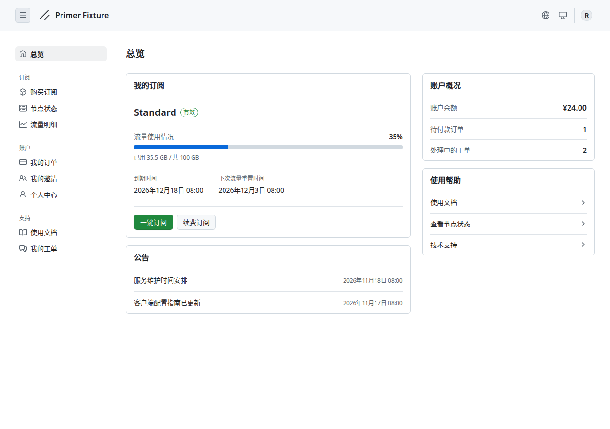

# Xboard Primer

基于 GitHub Primer Design System 的 Xboard 用户端主题。站长可以从 Xboard 后台上传 ZIP 并切换主题，用户可以继续使用已有的登录会话、订单书签和订阅链接。

<picture>
  <source media="(prefers-color-scheme: dark)" srcset="docs/dashboard-dark.png">
  
</picture>

## 安装和切换

1. 从 [v1.0 Release](https://github.com/Pectics/xboard-primer/releases/tag/v1.0) 的附件中下载 **Primer-v1.0.zip**。保留 ZIP 格式直接上传。
2. 在 Xboard 管理后台的主题管理页面上传该文件。上传完成后，主题列表中会出现 **Primer**。
3. 在站点的前端主题设置中选中 **Primer** 并保存，然后打开站点首页。主题设置中可以调整品牌标识配色、登录页背景和自定义页脚 HTML。

切回时，在同一设置中选回先前的主题并保存。升级时上传新版主题 ZIP，Xboard 会按主题名识别更新并保留该主题的既有配置。Docker 部署可直接在线切换，持久化 `/www/storage/theme` 可让上传的主题在容器重建后继续可用。

## 主题覆盖范围

- 登录、注册、找回密码、个人中心、账户余额与邀请。
- 订阅仪表盘、协议筛选、链接复制、二维码和客户端导入。
- 套餐购买、订单和结账、节点状态与流量明细。
- 知识库、公告、工单，以及桌面和移动端导航。
- 浅色、深色和跟随系统三种外观，八种界面语言，以及键盘导航。

主题使用宿主的 `/api/v1`。管理后台和服务端错误页由 Xboard 渲染，独立订阅地址由宿主接口响应。只有访客配置返回已启用的 `login_with_mail_link_enable` 时，主题才显示发送邮件登录链接的入口。常规账号密码登录独立工作。

v1.0 已在 [Xboard `d826a3b`](https://github.com/Pectics/Xboard/commit/d826a3b32f73bde24acce2a3ab033c6538ce121d) 上验证主题上传、启用、登录页渲染、静态资源加载和切回内置主题。

## 本地构建

开发环境需要 Node.js 22 或更高版本、npm 和 Info-ZIP 的 `zip` 命令。安装已构建的主题只需要 Xboard 本身。

```sh
npm ci
npm run build
npx playwright install chromium
npm test
```

`dist/Primer-v1.0.zip` 是可上传的安装包，`dist/Primer/` 是打包前的内容。构建脚本会把带内容哈希的资源文件名写入 Blade 模板。浏览器测试从这份构建产物加载用户端，并用固定数据验证路由、外观切换和交互。
